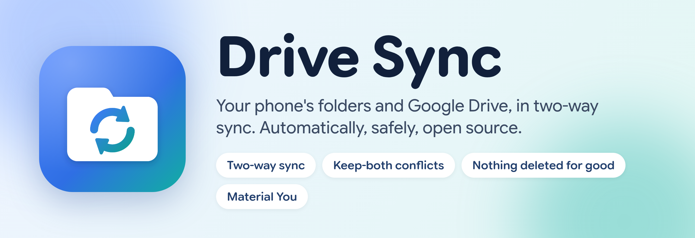
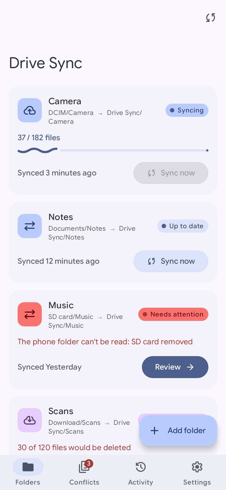
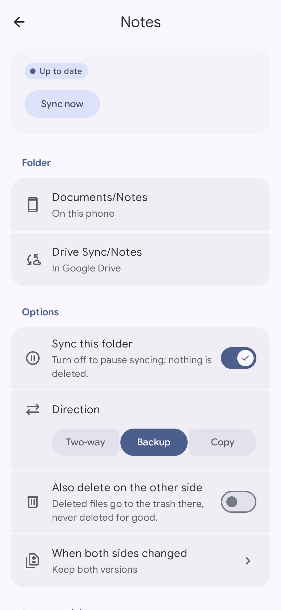
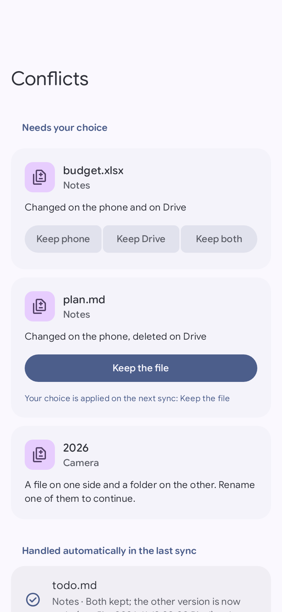
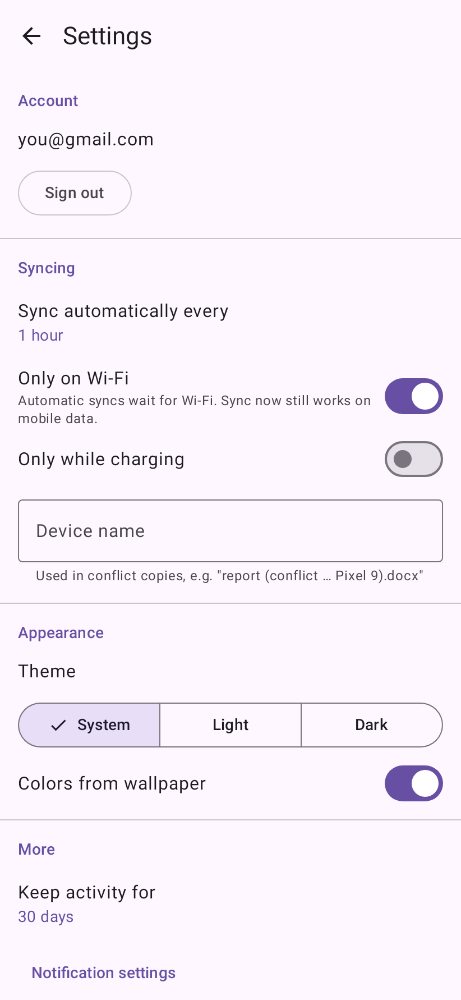
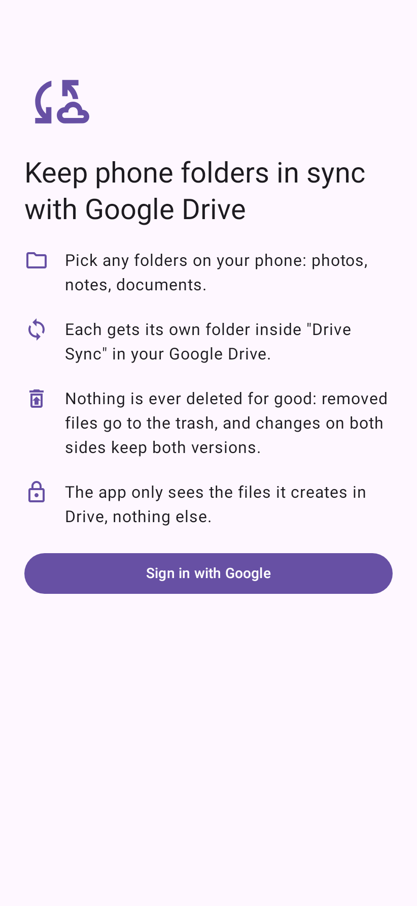
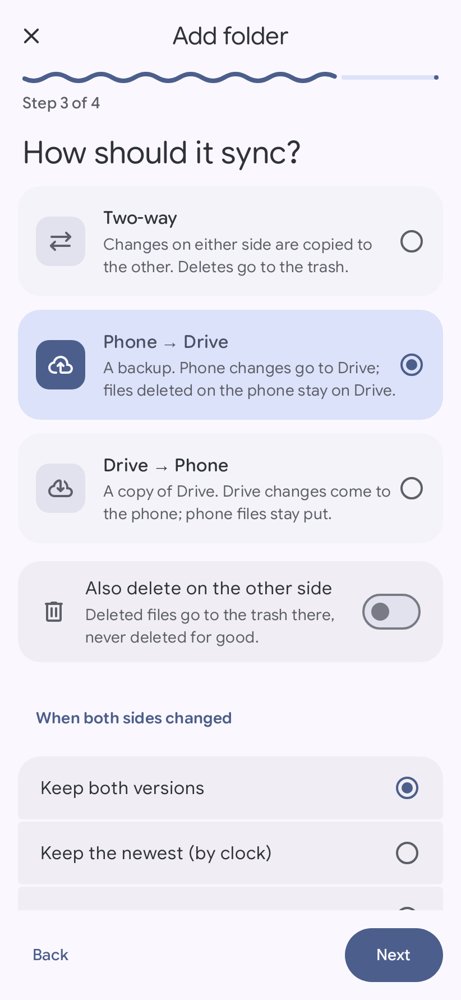
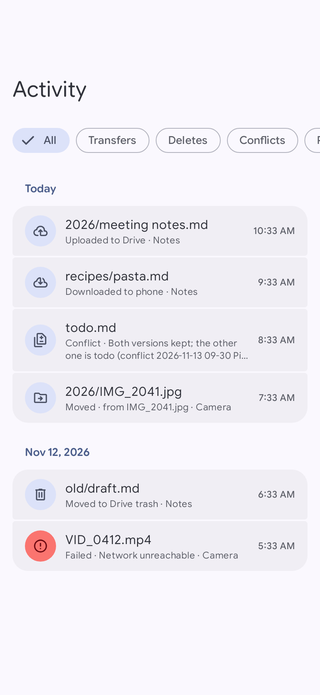
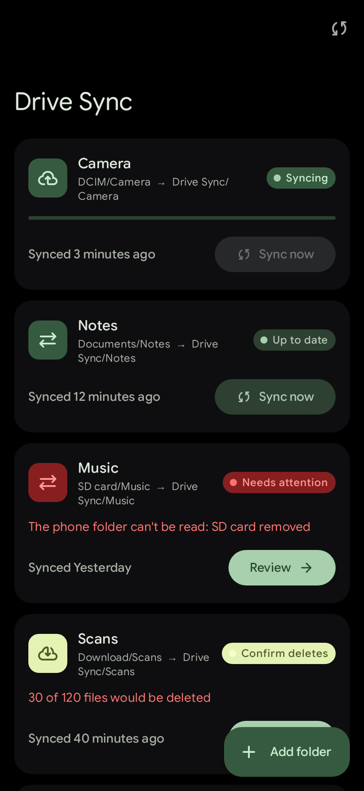

<p align="center">
  <picture>
    <source media="(prefers-color-scheme: dark)" srcset="docs/branding/banner-dark.png">
    
  </picture>
</p>

<p align="center">
  <a href="https://github.com/shonnoronha/driveSync/actions/workflows/ci.yml"></a>
  <a href="https://github.com/shonnoronha/driveSync/actions/workflows/release.yml"></a>
  
  
  
  
</p>

<p align="center"><b>Pick a folder on your phone. It shows up in Google Drive. Change it on either side, and the other side follows.</b><br>
No ads, no account of ours, no server in the middle: just your phone talking to your Drive.</p>

---

## Why another sync app?

Most Android "Drive sync" apps either only back up one way, or treat a missing folder as "the user deleted
everything" and happily empty your Drive. Drive Sync is built the other way around: **data safety first**, with
a sync engine that is a pure, exhaustively tested Kotlin library. It is designed to be boring in the best way.

## Screenshots

<p align="center">
  
  
  
  
</p>
<p align="center">
  
  
  
  
</p>

<sub>These are rendered on the JVM with a fixed accent. On your phone, the colors come from your wallpaper.</sub>

## Features

- **Any folder, many folders.** Photos, notes, documents, a whole Obsidian vault. Each one gets its own folder
  inside a **Drive Sync** folder in your Google Drive.
- **Real two-way sync**, or one-way **backup** (phone → Drive) or **copy** (Drive → phone), per folder.
- **Runs on its own.** Periodic syncs, about a minute after a new photo or video, when the app opens, and
  whenever you pull to refresh. Wi-Fi-only and charging-only if you like.
- **Conflicts never lose work.** When both sides changed a file, both versions are kept by default. You can also
  pick per file: keep the phone's, keep Drive's, or keep both.
- **Moves and renames** are detected, so a renamed photo is renamed on Drive instead of uploaded again.
- **Several phones, one Drive.** Reinstall, or set up a second phone, and link it to the same folders.
- **Material You, done properly.** Wallpaper colors, themed icon, Google Sans Flex, rounded Material Symbols,
  expressive motion, pure black mode, and an accent picker when wallpaper colors are off.

## Safety, in plain words

The sync engine enforces these on every run (they are tested, not just promised):

| | |
| --- | --- |
| 🛑 **Missing is not deleted** | An unplugged SD card, a revoked permission or a trashed Drive folder *pauses* the folder. It never turns into "delete everything". |
| 🗑️ **Nothing is deleted for good** | Deletes go to the Drive trash or a recycle folder on the phone. |
| ✋ **Big deletes wait for you** | If one sync would delete more than 20 files *and* more than 10% of a folder, it stops and asks. |
| 🧭 **No clock games** | Phone and Drive clocks are never compared against each other. Each side is compared with its own last-known state. |
| 🔁 **Re-checked before writing** | Every file is checked again right before it is overwritten. If it changed, it becomes a conflict instead. |
| ✍️ **No half-written files** | Downloads land in a hidden temp file and are verified (size + MD5) before they replace anything. Uploads are abandoned if the file changes mid-upload. |
| 🆕 **First sync only merges** | A new or re-linked folder never deletes anything on its first run. |

The full reasoning lives in [`docs/PRD.md`](docs/PRD.md) and the decision records in [`docs/decisions/`](docs/decisions/).

## Honest limits

- **Privacy-friendly scope.** The app asks only for Google's `drive.file` permission, so it can see *only the
  files it created*. Files you upload to the Drive Sync folders from the Drive website or other apps may not be
  visible to it. Files uploaded by the app on your other phones are.
- **Google Docs, Sheets and Slides** have no file content, so they are skipped (and listed in the folder's details).
- **Background timing is up to Android.** New photos sync within about a minute; other changes sync at the next
  periodic run (15 minutes to a day, your choice) or when you open the app.
- **Early development.** Every module is built and tested, but it has not been tried on real devices yet. Don't
  point it at your only copy of anything just yet.

## Build it yourself

You need **JDK 21** and the **Android SDK**.

```bash
./gradlew assembleDebug
```

Signing in needs your own Google Cloud OAuth client (Drive files are only visible to the OAuth client that created
them, so forks and self-builds always use their own):

1. In [Google Cloud Console](https://console.cloud.google.com/), create a project and enable the **Google Drive API**.
2. Configure the **OAuth consent screen** and add the `.../auth/drive.file` scope.
3. Create an **Android** OAuth client with package `io.github.drivesync` and the SHA-1 of your signing key
   (`./gradlew :app:signingReport` shows the debug one).
4. Create a **Web application** OAuth client and put its client id in `local.properties` (never committed):

   ```properties
   drivesync.googleServerClientId=1234567890-abc.apps.googleusercontent.com
   ```

## Under the hood

```
app                  Navigation shell, theme, WorkManager setup
feature-pairs        Folders list, add-folder wizard, folder details
feature-conflicts    Pending conflicts with per-file answers
feature-activity     Filterable activity log
feature-settings     Onboarding, settings
core-ui              Design system: theme, tokens, components, icons, font
core-sync            Pure Kotlin sync engine: three-way planner, executor (no Android imports)
core-data            Room database, base snapshots, settings (DataStore)
core-drive           Drive REST v3 client (Retrofit + OkHttp), Google sign-in, Drive Sync folders
core-local-storage   Storage Access Framework scanner and writer
core-work            WorkManager scheduling, triggers, notifications
```

Kotlin, Jetpack Compose with Material 3 Expressive, Hilt, Room, DataStore, WorkManager, Retrofit and
kotlinx.serialization. Tests use JUnit 5, Robolectric, MockWebServer (with an in-memory fake Drive) and Roborazzi
screenshot tests. Every core module has a 70% line-coverage gate; the sync engine sits at about 98%.

## Contributing

```bash
./gradlew detekt ktlintCheck      # style
./gradlew check -x lint           # unit tests and coverage gates
./gradlew :app:recordRoborazziDebug   # update app/screenshots after a UI change
```

Pull requests run the quick checks; the `release` branch runs the full build, Android lint and the screenshot
comparison. Design decisions are recorded as short ADRs in [`docs/decisions/`](docs/decisions/).

## Credits

- The visual design follows the Material style of [Mornye](https://github.com/mornyeapp/Mornye). Only the design
  ideas were used; none of its code or brand assets are included.
- [Google Sans Flex](https://github.com/googlefonts/googlesans-flex) (SIL Open Font License) and
  [Material Symbols](https://github.com/google/material-design-icons) (Apache 2.0); see [`docs/licenses/`](docs/licenses/).

## License

Not chosen yet (Apache-2.0 or GPL-3.0, see the open questions in the PRD). Until then, all rights reserved.

<sub>Drive Sync is a working name. It is an independent project, not affiliated with or endorsed by Google.
Google Drive is a trademark of Google LLC.</sub>
